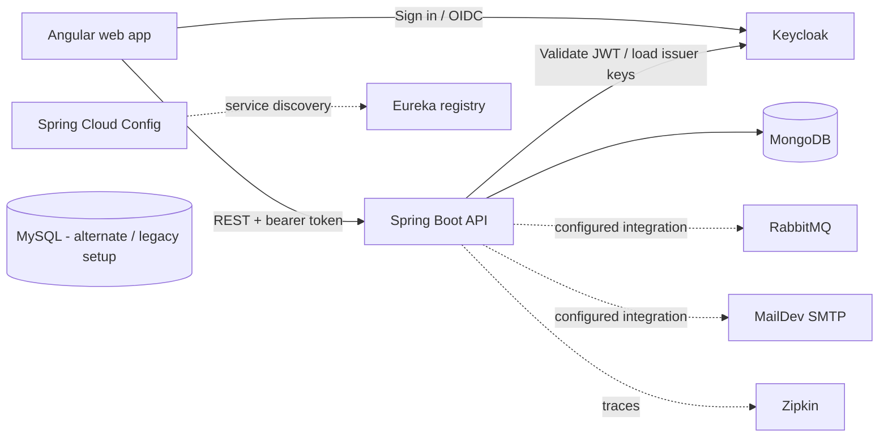

# Clinic Booking

Clinic Booking is a full-stack web application for managing clinic users, therapist availability, and appointments. The repository contains an Angular single-page application, a Spring Boot REST API, and local infrastructure configuration for identity, persistence, messaging, and service discovery.

## Architecture



The API is the application boundary for clinic data. MongoDB stores application documents such as users, therapists, timeslots, appointments, and prescriptions. The currently exposed service-type list is assembled by `ApplicationDataService`. Keycloak handles browser sign-in and issues JWTs; the API acts as an OAuth2 resource server and checks the token issuer, audience, and mapped roles. MySQL appears in alternate/legacy database configurations; the root Compose Keycloak service runs in development mode and does not configure MySQL as its database.

RabbitMQ, MailDev, Eureka, Spring Cloud Config, and Zipkin are supporting infrastructure in the repository. Eureka is used by the Config Server; the clinic API does not currently declare a Spring Cloud Config client dependency. These services are not all required for the basic calendar and availability flow. The root Compose file defines infrastructure containers; the Angular UI and clinic API are run separately during local development.

## Repository map

| Path | Purpose |
| --- | --- |
| `clinic-booking-ui/` | Angular 22 client application, routes, therapist calendar and availability forms, translations, Keycloak integration, and API clients. |
| `clinic-booking-service/` | Spring Boot 4 REST API, OAuth2 security, request validation, service logic, MongoDB repositories, models, DTOs, and mappers. |
| `configs/keycloak/` | Keycloak realm export used to seed the local identity provider. |
| `configs/repo/` | Spring Cloud Config configuration files. |
| `configs/mysql/` | MySQL initialization assets for the local infrastructure. |
| `config-server/` | Spring Cloud Config Server application. |
| `eureka-server/` | Eureka service registry application. |
| `docker-compose.yml` | Local infrastructure definitions, including MongoDB, MySQL, Keycloak, RabbitMQ, MailDev, Zipkin, Eureka, and Config Server. |
| `keycloak-docker-compose.yml`, `docker-db_kc-compose.yml` | Alternate Keycloak and database Compose configurations. |

The root `pom.xml` is a Maven aggregator for `clinic-booking-service` and `clinic-booking-ui`. The infrastructure services have their own Maven projects.

## Main application areas

### Angular UI

The UI uses standalone Angular components and routes. Its main areas are:

- **Home:** public landing page and entry point to sign-in.
- **Therapist workspace:** calendar view, availability submission, and timeslot editing. Calendar requests are scoped to the currently visible six-week grid.
- **Client workspace:** client dashboard shell. It currently requests example book data from a separate development endpoint at `http://localhost:8181/api/books`.
- **Admin workspace:** admin dashboard shell.
- **Shared services:** Keycloak integration, language selection, application metadata and service types, and HTTP API clients.

English and French translations live in `clinic-booking-ui/public/i18n/`. Angular obtains the API base URL from `clinic-booking-ui/src/environments/environment.ts` in development and `environment.prod.ts` in production. Keycloak's realm, client ID, and server URL are configured in `clinic-booking-ui/src/app/auth/keycloak.config.ts`.

### Spring Boot API

The API is organized into familiar layers:

- `controller/` exposes HTTP endpoints and applies route-level role rules.
- `service/` implements registration, therapist, appointment, and application-data operations.
- `repository/` provides MongoDB access.
- `model/` contains persisted domain objects.
- `dto/` defines request and response shapes; `mapper/` converts between DTOs and models.
- `security/` validates Keycloak JWTs and maps Keycloak roles to Spring authorities.
- `config/` contains application properties, Mongo auditing, and other Spring configuration.

The public application-data endpoint supplies the UI with the clinic title, organization code, and available service types. Authenticated endpoints use the logged-in user's JWT subject and roles to scope or authorize operations.

### API route overview

The main API runs under `clinic-booking-service` (port depends on the active Spring profile).

| Route | Purpose |
| --- | --- |
| `GET /api/public/application-data` | Public clinic metadata and available service types. |
| `POST /registeruser` | Register a client/user. |
| `POST /registerdoctor` | Register a therapist. |
| `POST /loginuser`, `POST /logindoctor` | Legacy login endpoints retained in the API. The current UI sign-in flow uses Keycloak. |
| `GET /api/v1/therapists/timeslots?startDate=YYYYMMDD&endDate=YYYYMMDD` | Get the authenticated therapist's timeslots for an inclusive date range. |
| `GET /api/v1/therapists/appointments?startDate=YYYYMMDD&endDate=YYYYMMDD` | Get appointments for the authenticated therapist and date range. |
| `POST /api/v1/therapists/timeslots` | Submit timeslots. |
| `PUT /api/v1/therapists/timeslots/{id}` | Update a pending timeslot. |

The therapist routes are protected by role checks. See the controller annotations and `security/SecurityConfig.java` for the authoritative access rules and additional legacy endpoints.

## Local development

### Requirements

- Java 26 and Maven
- Node.js 26.11.1 and npm 11.20.0 (the UI declares these versions)
- Docker with the Docker Compose plugin

### 1. Start the local dependencies

From the repository root, start the core development dependencies:

```powershell
docker compose up -d mongodb mysql keycloak rabbitmq mail-dev zipkin
```

MongoDB is published on port `27017`, Keycloak on `8080`, RabbitMQ on `5672` (management UI `15672`), MailDev SMTP on `1025` (web UI `1080`), Zipkin on `9411`, and MySQL on `3306`. The Compose files contain development defaults; replace them with local secrets before using the setup beyond a private development machine.

The local Keycloak configuration imports the realm from `configs/keycloak/`. The UI and API expect the `clinic-booking` realm at `http://localhost:8080`.

### 2. Start the API

In a second terminal:

```powershell
cd clinic-booking-service
mvn spring-boot:run -Dspring-boot.run.profiles=dev
```

The development profile configures the API for MongoDB and Keycloak and uses port `8088`. The base `application.properties` declares port `8081`; use the same profile and API URL expected by the UI when developing locally. The API's configured MongoDB and Keycloak issuer must be reachable from the host.

### 3. Start the UI

In a third terminal:

```powershell
cd clinic-booking-ui
npm ci
npm start
```

Open [http://localhost:4200](http://localhost:4200). The development UI calls the API at `http://localhost:8088` and Keycloak at `http://localhost:8080`. The UI loads application metadata during startup, so start the API first.

## Build and tests

Build the Spring Boot API from `clinic-booking-service/`:

```powershell
mvn package
```

Build the Angular UI from `clinic-booking-ui/`:

```powershell
npm run build
```

Run the available tests with `mvn test` in `clinic-booking-service/` or `npm test` in `clinic-booking-ui/`.

## Configuration reference

| Setting | Location | Notes |
| --- | --- | --- |
| API port and CORS origins | `clinic-booking-service/src/main/resources/application.properties` and `application-dev.yml` | Base port is `8081`; the dev profile currently uses `8088`. CORS defaults to `http://localhost:4200`. |
| API database and issuer settings | `clinic-booking-service/src/main/resources/application-dev.yml` | Development MongoDB and Keycloak issuer settings. Keep credentials out of committed files. |
| UI API base URL | `clinic-booking-ui/src/environments/environment.ts` and `environment.prod.ts` | Development points to `8088`; production currently points to `8081`. |
| Keycloak connection | `clinic-booking-ui/src/app/auth/keycloak.config.ts` | Realm `clinic-booking`, client `clinic-one-client`, local server `http://localhost:8080`. |
| Clinic metadata | `clinic-booking-service/src/main/resources/application-dev.yml` and `ApplicationDataService` | Title, version, organization code, and configured service types. |

## Notes for contributors

- Keep API date-range behavior consistent with the calendar's `YYYYMMDD` query parameters.
- Add new public endpoints under `/api/public/` only when they should be accessible without a bearer token.
- Keep English and French translation keys aligned when changing user-visible text.
- The repository includes legacy endpoints and configuration alongside the current Keycloak/MongoDB path. Check the active controller, profile, and UI service before relying on older examples or comments.
- Do not commit passwords, client secrets, exported production data, or real patient information.
